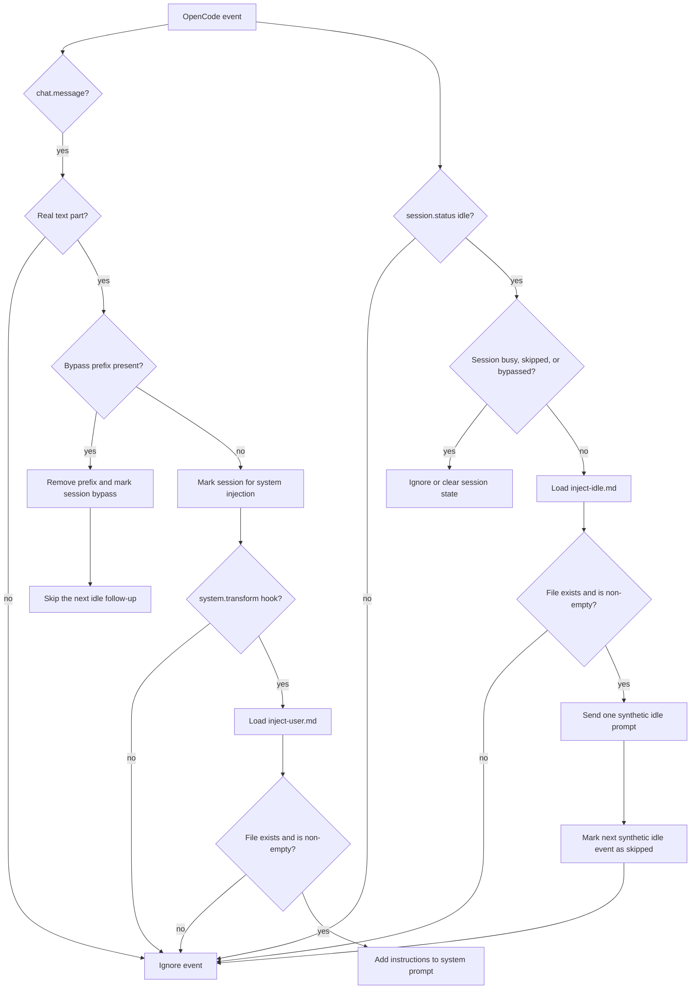

# OpenCode Context Injector

Project-file based context injection for OpenCode.

## Features

- Injects `.opencode/inject-user.md` into the system prompt for normal user
  requests.
- Runs `.opencode/inject-idle.md` once after a session becomes idle.
- Replaces `{{CURRENT_DATE}}` when an instruction file is read.
- Ignores synthetic idle messages to prevent cross-injection.
- Skips both injection chains for OpenCode `!` shell commands and slash
  commands.
- `? ` at the beginning bypasses both injection chains and is removed before
  the prompt reaches the model.
- Empty or missing project files disable the corresponding behavior.
- The Markdown files are user-editable prompt instructions, not hard-coded
  policy. Users can replace, customize, or empty them for each project.
- Installs the global `/setup-inject-context` command for copying or restoring
  the two original project templates.

## Technical Flow

The plugin registers five OpenCode hooks. It checks the worktree and project
directory in that order and uses the first valid instruction file it finds.
Files are read when the matching hook runs, so date placeholders and file
changes use the current content.

The system prompt hook is available in OpenCode `v1.18.31` and later. The
plugin does not append the user instructions to visible chat text, so older
OpenCode versions that do not call this hook cannot provide user injection.



### User Messages

For a normal message, the plugin finds the first non-synthetic text part and
marks the session for system injection. The system hook then adds the expanded
contents of `inject-user.md` without changing visible user text. If no valid
file is found, the request remains unchanged. The `? ` prefix removes itself
from the message and prevents the idle follow-up for that session cycle.
OpenCode shell messages beginning with `!` remain unchanged and suppress the
next idle follow-up. Slash commands are marked before execution and receive neither
injection. A normal request to run a command is still a regular model prompt.

### Idle Follow-up

When a session becomes idle, the plugin loads `inject-idle.md` and sends it as
one synthetic prompt. Shell activity, slash commands, and the `? ` bypass
suppress the next idle follow-up. Session state prevents parallel follow-ups and
skips the idle event generated by a synthetic prompt. A failed prompt clears the
state so a later idle event can retry.

### Configuration Boundary

The Markdown files define the prompt content and are fully user-editable. The
plugin controls only lookup, date expansion, bypass handling,
synthetic-message filtering, and idle state management.

## Project Guidance

The repository templates are references for short, precise project guidance.
The installer creates `.opencode/inject-user.md` and
`.opencode/inject-idle.md`; edit them directly for each project.

The global `/setup-inject-context` command only copies the original templates.
It does not inspect the project or create project-specific guidance. Without
`--force`, existing files are preserved. With `--force`, both files are
restored to the original template content. The command also explains what each
file is for and which content should not be added.

### Normal Requests

Use `templates/inject-user.md` as the baseline:

- Research external, version-dependent, or fast-changing facts only when needed.
- Inspect relevant project code for source-code questions.
- Use current documentation or tools when verification is needed.
- Do not guess; state uncertainty clearly.
- Answer directly, simply, and using verified facts.

### Idle Follow-Up

Use `templates/inject-idle.md` as the baseline:

- Treat the previous task as complete and do not start a new task.
- Check only for durable insights, decisions, or operational changes.
- Update and verify existing project documentation when a durable change exists.
- Do not document trivial actions or invent dashboard updates.
- End with a clear summary of the result, changes, verification, and uncertainty.
- Use verified facts only and end with a one-line poem.

## Install From GitHub

Clone the repository and run the installer for a project:

```bash
git clone https://github.com/nobiehl/opencode-context-injector.git
cd opencode-context-injector
./install.sh /path/to/project
```

The installer copies the plugin to
`~/.config/opencode/plugins/opencode-context-injector.js`, installs the global
`/setup-inject-context` command to `~/.config/opencode/commands/`, and creates
the two project templates only when they do not already exist. Existing files
are preserved. Set `OPENCODE_CONFIG_DIR` to use another user-level OpenCode
configuration directory. On Unix, `OPENCODE_PLUGIN_DIR` can override the
plugin directory independently.

Do not run the combined plugin together with separate `inject-user.js` or
`inject-idle.js` plugins. Disable those older plugins first to avoid duplicate
injections. The installer warns if it finds either legacy filename.

If an older installation left a project-local
`.opencode/commands/setup-inject-context.md`, the installer warns about it.
Remove that old project-local copy; the current command belongs in the global
OpenCode commands directory.

Restart OpenCode after installing or changing the plugin. Changes to the two
project Markdown files are loaded on the next matching event.

### Hook Diagnostics

Hook diagnostics are disabled by default. To verify hook execution without
logging instruction contents, set `OPENCODE_CONTEXT_INJECTOR_DEBUG=1` and start
OpenCode with `--print-logs`:

```powershell
$env:OPENCODE_CONTEXT_INJECTOR_DEBUG = "1"
opencode --print-logs
```

The plugin logs the session ID, hook names, whether system injection was
marked, and the injected character count through OpenCode's structured logger.
It does not log the instruction text. Restart OpenCode after changing the
environment variable.

## Windows Installation

Run PowerShell from the cloned repository:

```powershell
Set-ExecutionPolicy -Scope Process Bypass
.\install.ps1 -ProjectPath C:\path\to\project
```

The installer uses `OPENCODE_CONFIG_DIR` when set. Otherwise it installs the
plugin under `%USERPROFILE%\.config\opencode\plugins` and the command under
`%USERPROFILE%\.config\opencode\commands`, which are OpenCode's default
user-level paths on Windows.

## Local Development

OpenCode can also load `index.js` directly from a local plugin directory. The
package has no runtime dependencies.

## CI Testing Plan

The planned cross-platform CI design is documented in
[`docs/ci-testing-plan.md`](docs/ci-testing-plan.md). It covers Linux and
Windows installers, isolated OpenCode smoke checks, local plugin behavior
tests, and separately protected live provider checks.

## Context Budget

Generated `inject-user.md` and `inject-idle.md` files should contain verified,
project-specific context relevant to their respective injection points. There
is no enforced token or character limit.

The instruction guidance and context considerations are documented in
[`docs/context-budget.md`](docs/context-budget.md).

## Future Work

- Publish `opencode-context-injector` to npm.
- Support the official `opencode plugin <module>` installation path.
- Document registration through the OpenCode `plugin` configuration.
- Keep the installer as a bootstrap for project instruction files, because
  OpenCode installs plugins but does not create these project templates.
- Add CI coverage for npm installation and official plugin loading.

## License

MIT
